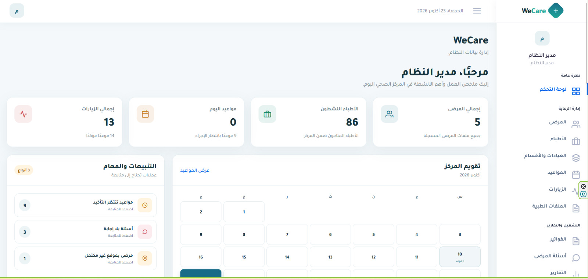
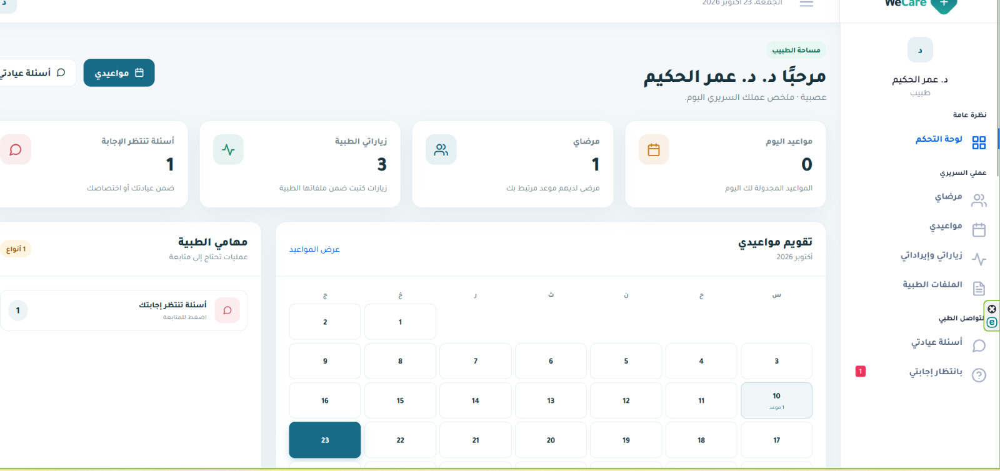
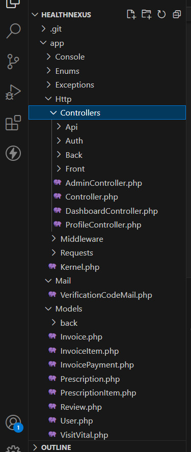

# HealthNexus – WeCare Healthcare Web Portal & RESTful API (Laravel Backend)

**HealthNexus** is the core backend platform and web management dashboard built with **PHP** and **Laravel** (backed by **MySQL**) that powers the **WeCare** healthcare ecosystem. It provides both a full-featured **Role-Based Web Dashboard** (for clinic administrators, doctors, and receptionists) and clean **RESTful JSON APIs** consumed by the cross-platform mobile app.

> **Mobile Frontend Repository:** The Flutter mobile client consuming these APIs is available at [**WeCare (Flutter App)**](https://github.com/aylasrhan/wecare-app).  
> **Technical & Functional Documentation:** Detailed project inventory is documented in [`docs/PROJECT_INVENTORY_AR.md`](docs/PROJECT_INVENTORY_AR.md).

---

## Core Capabilities & Architecture

- **Multi-Role Web Portal (Admin, Doctor, Receptionist):** Dedicated dashboards with role-based access control (`Auth`, `Back`, `Front` controllers) for managing clinics, schedules, medical records, and billing.
- **RESTful Mobile API (`Api` Controllers):** Structured, token-authenticated JSON endpoints serving real-time data to the Flutter mobile client.
- **Clinical & Financial Data Modeling:** Comprehensive relational **MySQL** architecture (`User`, `Prescription`, `PrescriptionItem`, `VisitVital`, `Invoice`, `InvoiceItem`, `InvoicePayment`, `Review`).
- **Automated Notifications & Verification:** Integrated email verification workflows (`VerificationCodeMail`) and appointment status tracking.

---

## Tech Stack

- **Language & Framework:** PHP 8, Laravel
- **Database:** MySQL (Relational Schema)
- **Architecture:** MVC, Modular Controller Separation (`Api`, `Auth`, `Back`, `Front`), RESTful JSON APIs

---

## System Previews & Architecture

| Admin Dashboard | Doctor Portal |
| :---: | :---: |
|  |  |

| Receptionist Dashboard | Project Structure |
| :---: | :---: |
| .jpeg) |  |

---

## Getting Started

1. **Clone the repository:**
   ```bash
git clone https://github.com/aylasrhan/HealthNexus.git
